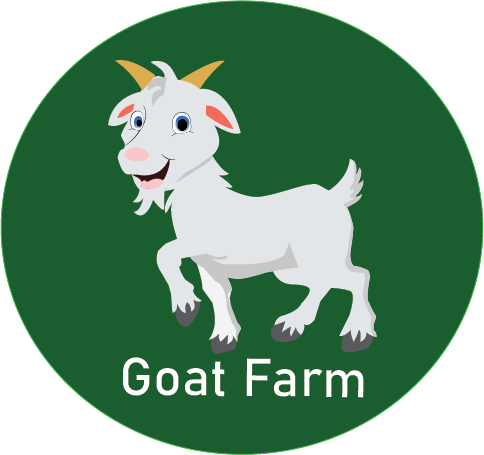

# 🐑 DombaKu (Dombaku)

<p align="center">
  
</p>

<p align="center">
  <strong>Aplikasi Manajemen Peternakan Modern & Sistem Kemitraan Bagi Hasil Ternak Domba/Kambing Berbasis Android</strong>
</p>

<p align="center">
  
  
  
  
  
  
  
</p>

---

## 📖 Tentang DombaKu

**DombaKu** adalah aplikasi mobile berbasis Android yang dirancang khusus untuk memodernisasi tata kelola peternakan domba dan kambing, dengan fokus utama pada **transparansi kemitraan (sistem parohan / bagi hasil)** antara **Pengurus Ternak (Peternak/Admin Kandang)** dan **Pemilik Ternak (Investor/Mitra Pemodal)**.

Aplikasi ini mengatasi kendala konvensional seperti pencatatan manual buku ternak, ketidakjelasan status kondisi ternak, pelacakan garis keturunan (silsilah), hingga kerumitan dalam pembagian hasil penjualan dan anakan baru.

---

## ✨ Fitur Utama

Aplikasi mendukung **Multi-Role User** dengan hak akses dan tampilan yang disesuaikan secara dinamis:

### 1. 🧑‍🌾 Peran: Pengurus (Admin / Peternak Kandang)
* **Dashboard Statistik Real-Time**:
  * Total populasi domba aktif (hidup & belum terjual).
  * Distribusi jumlah jantan, betina, anakan, dan domba terjual.
  * Akumulasi pendapatan bagi hasil pengurus.
* **Manajemen Data Ternak (CRUD Domba)**:
  * Tambah data domba baru atau anakan baru.
  * Form identitas lengkap: ID Domba, Kode Tag (ear tag), Nama, Jenis Kelamin (Jantan/Betina), Jenis Ras, Asal Kambing, Tanggal Masuk, Berat Badan (kg), Harga Modal/Beli, dan Estimasi Harga Jual.
  * Penetapan status kondisi: `SEHAT`, `SAKIT`, `TERJUAL`, `MATI`.
  * Penetapan skema kepemilikan: `MILIK_SENDIRI`, `BAGI_HASIL`, `TITIPAN`.
  * Asosiasi id induk jantan dan betina untuk pencatatan genealogi.
  * Asosiasi pemilik ternak (investor).
* **Detail & Aksi Domba (Modal Bottom Sheet)**:
  * Update kondisi terkini, berat badan, atau catatan perawatan.
  * Pencatatan transaksi penjualan ternak langsung dari kartu detail domba.
* **Manajemen Kemitraan (Investor Onboarding)**:
  * Mendaftarkan (*pre-register*) calon mitra/pemilik modal (Nama, Email, No. HP).
  * Melihat daftar semua mitra pemilik terdaftar.
* **Laporan Keuangan & Penjualan**:
  * Riwayat transaksi penjualan ternak.
  * Rekapitulasi keuntungan kotor, bagian pemilik, dan bagian pengurus.
  * Filter riwayat transaksi berdasarkan periode bulan.

### 2. 💼 Peran: Pemilik (Investor / Mitra)
* **Aktivasi Akun Mandiri**:
  * Investor mengaktifkan akun secara mandiri menggunakan email yang telah didaftarkan oleh pengurus, lalu membuat kata sandi (*password*) sendiri.
* **Dashboard Portofolio Investor**:
  * Total domba aktif milik pribadi.
  * Jumlah domba yang telah terjual dan domba sehat.
  * Estimasi potensi bagi hasil dari domba jantan siap jual.
* **Katalog Domba Saya**:
  * Menampilkan hanya domba-domba yang dimiliki oleh akun investor yang bersangkutan secara real-time.
* **Pohon Silsilah Ternak (Genealogy / Pedigree Tree)**:
  * Pelacakan garis keturunan anakan secara visual dan hierarkis berdasarkan relasi induk jantan & betina.
* **Laporan Bagi Hasil Transparan**:
  * Pantau transparansi profit sharing dan penjualan aset ternak.

---

## 🧮 Logika Bisnis & Algoritma Bagi Hasil

DombaKu mengimplementasikan sistem perhitungan syirkah / parohan tradisional yang diotomatisasi melalui use-case domain yang teruji:

### 1. Pembagian Anakan (`BagiAnakanUseCase`)
Menggunakan skema parohan murni 50:50:
* **Jumlah Anakan Genap**:
  $$\text{Jatah Pemilik} = \frac{N}{2}, \quad \text{Jatah Pengurus} = \frac{N}{2}$$
* **Jumlah Anakan Ganjil**:
  $$\text{Jatah Pemilik} = \lfloor\frac{N}{2}\rfloor, \quad \text{Jatah Pengurus} = \lfloor\frac{N}{2}\rfloor, \quad \text{Anak Bersama (Joint)} = 1 \text{ ekor (Status: BAGI\_HASIL)}$$

### 2. Bagi Hasil Penjualan Ternak (`HitungBagiHasilUseCase`)
* **Keuntungan Bersih**:
  $$\text{Untung Bersih} = \text{Harga Jual} - \text{Harga Modal}$$
* **Skema `BAGI_HASIL`**:
  * Jika Untung: Bagian Pemilik 50%, Bagian Pengurus 50%.
  * Jika Rugi: Ditanggung oleh modal pemilik (pengurus tidak dikenakan potongan biaya).
* **Skema `FULL_PEMILIK` / `TITIPAN`**:
  * Keuntungan 100% dialokasikan kepada pemilik (pengurus menerima kompensasi jasa/upah terpisah).

### 3. Estimasi Umur & Bobot Pasar (`DateUtils` & `Kalkulator`)
* Perhitungan umur otomatis (format hari, bulan, atau tahun) berdasarkan `tanggal_masuk`.
* Estimasi harga pasar berdasarkan bobot riil ($\text{Berat (kg)} \times \text{Harga Patokan/kg}$).

---

## 🏗️ Arsitektur Aplikasi

Proyek ini dibangun mengikuti kaidah **Clean Architecture** dan pola **MVVM (Model-View-ViewModel)** dengan **Uni-directional Data Flow (UDF)**:

```
app/src/main/java/com/app/dombaku/
├── DombakuApp.kt             # Application class (Service locator & inisialisasi Repository)
├── MainActivity.kt           # Single Activity host dengan Compose Navigation Host
├── data/
│   ├── model/                # Data Transfer Objects & Domain Models
│   │   ├── Kambing.kt        # Entitas ternak (kambing/domba)
│   │   ├── user.kt           # Entitas pengguna (pengurus/pemilik)
│   │   ├── Kawin.kt          # Model perkawinan & hasil bagi
│   │   ├── Kelahiran.kt      # Model pencatatan kelahiran
│   │   ├── KepemilikanDomba.kt # Enum skema kepemilikan (FULL_PEMILIK, BAGI_HASIL, TITIPAN)
│   │   └── TransaksiKambing.kt # Model transaksi jual-beli-biaya
│   └── repository/           # Lapisan data & integrasi Cloud Firestore
│       ├── AuthRepository.kt # Autentikasi Firebase, pre-registrasi, aktivasi, manajemen profil
│       ├── KambingRepository.kt # Real-time listener & operasi data ternak
│       ├── KelahiranRepository.kt
│       └── TransaksiKambingRepository.kt
├── domain/
│   └── usecase/              # Logika bisnis murni (independen dari framework UI)
│       ├── BagiAnakanUseCase.kt     # Rumus pembagian anakan baru
│       └── HitungBagiHasilUseCase.kt # Rumus profit sharing penjualan
├── ui/
│   ├── theme/                # Tema Material 3 (Color, Typography, Theme)
│   │   └── screens/          # Halaman antarmuka Jetpack Compose
│   │       ├── AktivasiAkunScreen.kt # Aktivasi akun investor
│   │       ├── Loginscreens.kt       # Halaman login
│   │       ├── Registerscreens.kt    # Registrasi akun pengurus
│   │       ├── splashscreens.kt      # Splash screen & routing sesi
│   │       ├── auth/
│   │       │   ├── pemilik/          # Halaman khusus Pemilik/Investor
│   │       │   │   ├── Investordasboard.kt
│   │       │   │   └── Silsilahkambing.kt
│   │       │   └── pengurus/         # Halaman khusus Pengurus/Admin
│   │       │       ├── AccountScreen.kt
│   │       │       ├── Adminscreens.kt
│   │       │       ├── Dasboardscreens.kt
│   │       │       ├── Detaildombascreens.kt
│   │       │       ├── Dombalistscreens.kt
│   │       │       ├── Laporankambing.kt
│   │       │       └── Tamabahdomba.kt
│   └── viewmodel/            # State management berbasis StateFlow
│       ├── AuthViewModel.kt
│       ├── DashboardViewModel.kt
│       ├── DombaListViewModel.kt
│       ├── KambingViewModel.kt
│       ├── SilsilahViewModel.kt
│       └── ViewModelFactory.kt
└── utils/                    # Helper & formatting
    ├── dateutils.kt          # Manipulasi tanggal & hitung umur
    └── kalkulator.kt         # Formatting mata uang Rupiah & validasi nominal
```

---

## 🛠️ Tech Stack & Dependensi

* **Bahasa**: [Kotlin](https://kotlinlang.org/) (JVM Target 17)
* **UI Framework**: [Jetpack Compose](https://developer.android.com/jetpack/compose) dengan [Material Design 3 (Material3)](https://m3.material.io/)
* **Arsitektur**: MVVM + Clean Architecture
* **Navigasi**: [Navigation Compose](https://developer.android.com/jetpack/compose/navigation) (v2.7.7)
* **Asinkron & Reaktivitas**: Kotlin Coroutines & `Flow` (`StateFlow`, `callbackFlow`)
* **Backend & Database**:
  * **Firebase Authentication**: Autentikasi berbasis email & kata sandi
  * **Cloud Firestore**: Database NoSQL dokumen dengan sinkronisasi real-time (`addSnapshotListener`)
* **Build System**: Gradle Version Catalogs (`libs.versions.toml`) dengan Gradle Wrapper

---

## 🗄️ Skema Database (Cloud Firestore)

### 1. Koleksi `users`
Menyimpan data profil akun pengguna (pengurus dan pemilik).

| Field | Tipe | Keterangan |
| :--- | :--- | :--- |
| `uid` | `String` | ID Dokumen (sesuai Firebase Auth UID untuk akun aktif) |
| `nama` | `String` | Nama lengkap pengguna |
| `email` | `String` | Email pengguna |
| `role` | `String` | `"pengurus"` atau `"pemilik"` |
| `status` | `String` | `"active"` (sudah aktivasi) atau `"pending"` (belum aktivasi) |
| `noHp` | `String` | Nomor telepon / WhatsApp |
| `saldoProfit` | `Number` | Akumulasi saldo profit bagi hasil |
| `createdAt` | `Number` | Timestamp pendaftaran akun (milidetik) |

### 2. Koleksi `kambing`
Menyimpan data induk dan anakan ternak.

| Field | Tipe | Keterangan |
| :--- | :--- | :--- |
| `id_kambing` | `String` | ID identifikasi internal / nomor registrasi kandang |
| `kode_tag` | `String` | Kode eartag fisik pada telinga kambing |
| `nama` | `String` | Nama panggilan ternak |
| `pemilik_id` | `String` | UID atau ID dokumen akun pemilik / investor |
| `jenis_kelamin`| `String` | `"JANTAN"` atau `"BETINA"` |
| `jenis` | `String` | Ras domba (cth: Garut, Texel, Dorper, dsb.) |
| `berat` | `Double` | Berat badan terkini (kg) |
| `harga_beli` | `Number` | Harga modal / pembelian awal (Rp) |
| `estimasi_harga_jual` | `Number` | Estimasi nilai jual saat ini (Rp) |
| `status_kondisi` | `String` | `"SEHAT"`, `"SAKIT"`, `"TERJUAL"`, atau `"MATI"` |
| `status_kepemilikan` | `String` | `"MILIK_SENDIRI"`, `"BAGI_HASIL"`, atau `"TITIPAN"` |
| `tanggal_masuk` | `String` | Tanggal masuk kandang (`YYYY-MM-DD`) |
| `id_induk_jantan` | `String?` | ID domba bapak/pejantan (opsional) |
| `id_induk_betina` | `String?` | ID domba ibu/induk betina (opsional) |
| `asal_kambing` | `String` | Asal ternak (pasar, ternak mandiri, mitra luar) |

---

## 🚀 Panduan Memulai (Getting Started)

### 1. Prasyarat Sistem
* **Android Studio**: Iguana (2023.2.1), Koala (2024.1.1), Ladybug, atau versi yang lebih baru.
* **JDK**: Java Development Kit 17 (disertakan langsung di Android Studio).
* **Android SDK**:
  * Minimum SDK: API 24 (Android 7.0 Nougat)
  * Compile & Target SDK: API 34 (Android 14)
* Perangkat fisik Android atau Emulator Android dengan Google Play Services.

### 2. Kloning Repositori
```bash
git clone https://github.com/<username>/Dombaku.git
cd Dombaku
```

### 3. Konfigurasi Firebase
Aplikasi ini memerlukan proyek Google Firebase:
1. Masuk ke [Firebase Console](https://console.firebase.google.com/).
2. Buat proyek baru (misalnya `Dombaku`).
3. Tambahkan aplikasi Android dengan Package Name:
   ```
   com.app.dombaku
   ```
4. Unduh file `google-services.json` dan letakkan di dalam folder `app/`:
   ```
   Dombaku/app/google-services.json
   ```
5. Di Firebase Console:
   * **Authentication**: Aktifkan metode sign-in **Email/Password**.
   * **Firestore Database**: Buat database dalam mode pengujian (*test mode*) atau atur aturan keamanan (*Security Rules*) sesuai kebijakan Anda.

Contoh dasar aturan keamanan Firestore (`firestore.rules`):
```javascript
rules_version = '2';
service cloud.firestore {
  match /databases/{database}/documents {
    match /users/{userId} {
      allow read, write: if request.auth != null;
    }
    match /kambing/{kambingId} {
      allow read, write: if request.auth != null;
    }
    match /transaksi_kambing/{transaksiId} {
      allow read, write: if request.auth != null;
    }
  }
}
```

### 4. Build dan Jalankan Aplikasi
1. Buka folder proyek di **Android Studio**.
2. Tunggu proses **Gradle Sync** selesai secara otomatis.
3. Hubungkan perangkat Android via USB Debugging atau jalankan Android Emulator.
4. Klik tombol **Run** (`Shift + F10` atau ikon segitiga hijau) pada konfigurasi `app`.

Untuk build APK secara manual via terminal:
```bash
# Debug APK
./gradlew assembleDebug

# Release APK
./gradlew assembleRelease
```
File APK output berada di `app/build/outputs/apk/debug/app-debug.apk`.

---

## 📱 Alur Penggunaan Aplikasi (Workflow)

```mermaid
flowchart TD
    Start([Buka Aplikasi]) --> Splash[Splash Screen]
    Splash --> AuthCheck{Punya Akun?}
    
    AuthCheck -- Tidak / Pengurus Baru --> RegPengurus[Daftar Pengurus Baru]
    RegPengurus --> Login[Login Screen]
    
    AuthCheck -- Belum Diaktivasi / Pemilik --> Aktivasi[Aktivasi Akun Pemilik\n(Cek email terdaftar & buat kata sandi)]
    Aktivasi --> Login
    
    AuthCheck -- Ya --> Login
    Login --> RoleCheck{Cek Role Pengguna}
    
    RoleCheck -- Pengurus --> AdminDashboard[Dashboard Pengurus]
    AdminDashboard --> ManageDomba[Kelola Data Domba & Tambah Domba]
    AdminDashboard --> PreReg[Pre-Register Pemilik / Investor]
    AdminDashboard --> LaporanAdmin[Lihat Laporan Penjualan & Margin]
    
    RoleCheck -- Pemilik --> InvestorDashboard[Dashboard Investor]
    InvestorDashboard --> MyDomba[Lihat Domba Saya]
    InvestorDashboard --> Silsilah[Pohon Silsilah Ternak]
    InvestorDashboard --> LaporanInvestor[Pantau Bagi Hasil]
```

1. **Pendaftaran Pengurus**: Pengurus mendaftar langsung dari halaman Registrasi aplikasi.
2. **Pre-Registrasi Pemilik**: Pengurus mendaftarkan mitra pemodal melalui form pendaftaran mitra (status awal: `pending`).
3. **Aktivasi Pemilik**: Mitra membuka aplikasi, masuk ke menu **Aktivasi Akun**, memasukkan email yang didaftarkan pengurus, dan menetapkan kata sandi baru (status berubah menjadi: `active`).
4. **Pencatatan Ternak**: Pengurus menambahkan ternak dan menetapkan kepemilikannya ke mitra terkait.
5. **Monitoring Real-Time**: Investor dapat langsung memantau ternak miliknya secara transparan dari perangkat mereka.

---

## 🤝 Kontribusi

Kontribusi selalu terbuka untuk perbaikan fitur maupun dokumentasi:
1. *Fork* repositori ini.
2. Buat *feature branch* baru (`git checkout -b feature/FiturKeren`).
3. Lakukan *commit* perubahan (`git commit -m 'Menambahkan fitur kalkulasi pakan'`).
4. *Push* ke branch Anda (`git push origin feature/FiturKeren`).
5. Buat sebuah **Pull Request**.

---

## 📄 Lisensi

Proyek ini dikembangkan di bawah lisensi [MIT](LICENSE). Silakan gunakan dan kembangkan untuk kemajuan ekosistem peternakan digital Indonesia.

---

<p align="center">
  Dibuat dengan ❤️ untuk kemajuan peternak dan kemitraan ternak modern di Indonesia.
</p>

